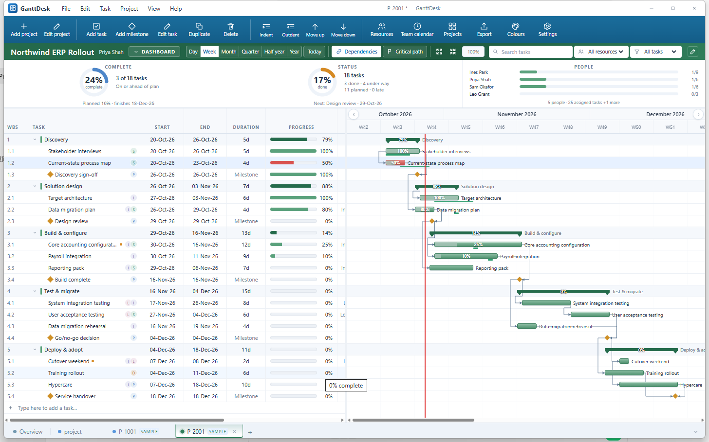

# GanttDesk

一个离线的桌面甘特图 / 项目计划工具：纯前端界面 + Tauri 单文件 exe，数据就放在 exe 同级的
`ProjectPlan.dplan` 里，不依赖服务器、账号或云同步。

An offline desktop Gantt planner: a plain HTML/JS front end wrapped in a single Tauri
executable. The whole workspace lives in `ProjectPlan.dplan` next to the exe — no server,
no account, no cloud.



---

## 下载 / Download

- 到 **Releases** 下载 `GanttDesk.exe`（Windows 10/11，需系统自带 WebView2）。
- 双击运行即可；首次启动会在 exe 同级生成 `ProjectPlan.dplan`。
- Save / Open 始终读写这个文件，换电脑时把 exe 和 `.dplan` 一起拷走即可。

Download `GanttDesk.exe` from **Releases**. Windows 10/11 with the built-in WebView2
runtime. The workspace file `ProjectPlan.dplan` is created next to the exe on first run;
copy both files to move a plan to another machine.

---

## 功能 / Features

**计划编制**

- 大纲 / WBS：任务、里程碑、父子层级、折叠、拖拽排序、缩进与升级。
- 多选批量操作：Ctrl / Shift 多选后，升级、降级、上移、下移按整组生效。
- 依赖关系：FS / SS / FF / SF 四种类型与 lag。
- 关键路径：基于当前排期计算最晚开始/完成、总浮动、自由浮动（不依赖基线）。
- 基线：一键捕获/清除，基线任务条与偏差列。
- 日历：工作日、工作时段、节假日、特殊工作日。
- 实际进度：实际开始/完成、进度条拖动、延期任务高亮。
- 多项目：标签页、固定 Overview、项目管理（搜索 / 筛选 / 进度 / 归档 / 删除）。
- 项目引用：把一个项目作为阶段嵌入当前计划，跨项目编辑回写源项目。

**资源与视图**

- 资源池、角色、费率、人员颜色；任务条可按“第一个已分配资源”着色（可开关）。
- Dashboard：完成率、成本、状态、人员四张卡片，统计包含引用项目。
- 主题与配色：10 套主题预设、5 种任务条形状、优先级颜色、延误颜色自定义。
- 缩放：小时 / 天 / 周 / 月 / 季度 / 半年 / 年；搜索、资源筛选、任务筛选。

**导出**

- PDF：直接生成多页 A3 横向 PDF（约 288 dpi，图像型，版式与屏幕一致）。
- PNG：所有页纵向拼接为一张 A3 横向长图。
- Excel (.xls) / CSV / `.dplan` 项目备份。

**桌面版**

- 单文件 exe（约 2.8 MB），无安装器、无外部依赖。
- 无边框窗口，标题栏内自带拖动区与最小化 / 最大化 / 关闭。
- 全部数据本地保存，断网可用。

---

## 快速开始 / Quick start

1. 打开 `GanttDesk.exe`。
2. `Add project` 新建项目，或直接在内置示例项目上试用。
3. `Add task` 添加任务，双击单元格就地编辑，拖动任务条改期。
4. `File → Save`（Ctrl+S）把整个工作区写入 `ProjectPlan.dplan`。
5. `Export` 导出 PDF / PNG / Excel。

---

## 从源码构建 / Build from source

前端是原生 HTML/CSS/JS，无需 Node 或打包器；桌面外壳使用 Tauri v2。

```powershell
# 1. Rust（Windows GNU 工具链）
rustup toolchain install stable-x86_64-pc-windows-gnu
rustup default stable-x86_64-pc-windows-gnu

# 2. MinGW-w64：需要 gcc、as、dlltool、windres 在 PATH 中
#    例如 WinLibs / MSYS2 的 mingw-w64-x86_64-gcc 与 binutils

# 3. 编译（build.rs 会把 index.html、styles.css、js/ 同步到 dist/ 再嵌入 exe）
cd src-tauri
cargo build --release
```

产物为 `src-tauri/target/release/ganttdesk.exe`，复制出来即可运行。

`src-tauri/.cargo/config.toml` 里配置了国内 crates 镜像（rsproxy），海外构建可删除该文件。

Development notes: the UI is plain HTML/CSS/JS (`index.html`, `styles.css`, `js/`).
`src-tauri/build.rs` copies those assets into `dist/` before the Tauri build embeds them.
`styles.css` is also inlined into `index.html` so PDF/PNG export can read the CSSOM when
opened from `file://` — keep the two copies in sync.

---

## 数据文件 / Files

| 文件 | 说明 |
| --- | --- |
| `ProjectPlan.dplan` | 工作区 JSON：所有标签页、设置、项目与任务。exe 同级，可备份/迁移。 |
| `*.dplan` / `*.json` | `File → Open` 可读取单项目或整个工作区；兼容旧格式。 |
| `.xls` / `.csv` | 由导出生成，用于 Excel / Numbers / LibreOffice。 |

浏览器模式下工作区自动保存到 `localStorage`；桌面模式则直接写 `ProjectPlan.dplan`。

---

## 快捷键 / Shortcuts

| 快捷键 | 功能 |
| --- | --- |
| `Ctrl+N` / `Ctrl+O` / `Ctrl+S` | 新建 / 打开 / 保存 |
| `Ctrl+P` | 导出 PDF |
| `Ctrl+Z` / `Ctrl+Y` | 撤销 / 重做 |
| `Ctrl+A` / `Delete` | 全选 / 删除任务 |
| `Insert` / `F2` | 添加任务 / 编辑任务 |
| `Tab` / `Shift+Tab` | 下一个 / 上一个单元格 |
| `Ctrl+Click` / `Shift+Click` | 多选任务 |
| `Ctrl+滚轮` | 以指针为中心缩放时间轴 |
| 中键拖动 | 平移时间轴 |

---

## 已知限制 / Limitations

- PDF 为图像型（不可选中文字），换取版式稳定与零外部依赖。
- 单窗口桌面应用；不支持系统文件关联与自动更新。
- 计划数据为单个 JSON 文件，超大项目（数千行）仍可用，但首次加载会略慢。

---

## 许可证 / License

[MIT](LICENSE) © 2026 Tao Zhang

---

## 支持作者 / Support

如果这个工具帮到了你，可以扫码请作者喝杯咖啡（完全自愿，不影响任何功能）。

If GanttDesk saves you some time, you can buy the author a coffee — entirely optional.

<p>
  
  &nbsp;&nbsp;&nbsp;
  
</p>
